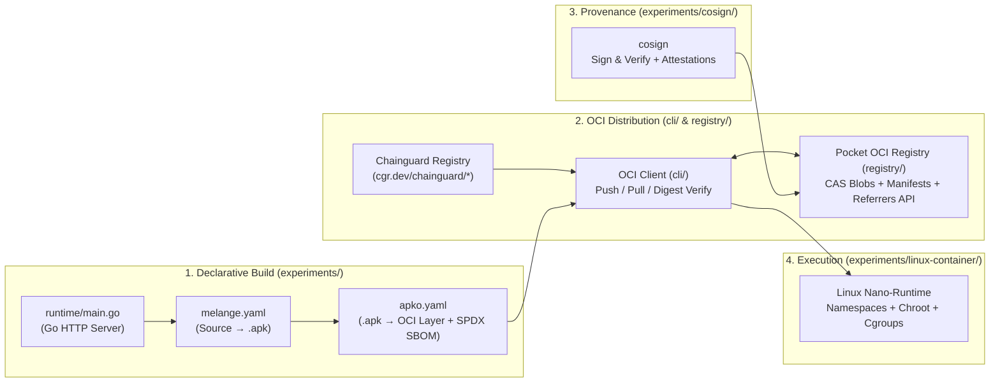

# Frankenstein-CI

> **A from-scratch exploration of the OCI ecosystem, Linux container internals, declarative Wolfi/`apko`/`melange` image builds, and cryptographic supply chain provenance in Go.**

`frankenstein-ci` is a miniature end-to-end container factory built without relying on the `docker` daemon or imperative `Dockerfile` builds. Every component is implemented or wired from first principles to dissect how hardened, distroless container images are built, distributed, verified, and executed.

---

## Architecture & End-to-End Flow



---

## Repository Map

```text
frankenstein-ci/
├── go.mod
├── README.md
│
├── cli/                     # Milestone 1: Pure-Go OCI Registry Client (Pull & Push)
│   └── pull.go              # Token handshake, multi-arch OCI Index resolution, parallel layer downloads & whiteout extraction
│
├── registry/                # Milestone 4: OCI Distribution Spec Registry Server
│   ├── cmd/
│   │   └── main.go          # HTTP server entrypoint
│   └── internal/            # Content-addressable blob store (SHA-256), upload sessions, manifest & OCI 1.1 referrers index
│
├── experiments/             # Hands-on dissections of container internals & Chainguard tooling
│   ├── linux-container/     # Milestone 2: Linux Nano-Runtime (namespaces, chroot, /proc mount, cgroups)
│   │   └── main.go
│   ├── runtime/             # Milestone 3 Target App: Minimal Go HTTP server packaged via melange & apko
│   │   └── main.go
│   ├── apko/                # Milestone 3a: Declarative Wolfi image assembly & build-time SPDX SBOMs
│   │   ├── apko.yaml
│   │   └── sbom-*.spdx.json
│   ├── melange/             # Milestone 3b: Compiling Go source into a signed Wolfi .apk package
│   ├── cosign/              # Milestone 5: Cryptographic image signing & attestation verification
│   └── images/              # Extracted root filesystems (e.g., cgr.dev/chainguard/static) for inspection
│
├── pkg/                     # Shared Go libraries across CLI and Registry
│   ├── host/                # Host OS/architecture detection & OCI platform normalization
│   │   └── arch.go
│   └── rest/                # Generic typed HTTP/JSON client
│       └── client.go
│
└── bruno/                   # API request collection for inspecting OCI registry handshakes & manifests
```

---

## Milestones

### Milestone 1: The Raw OCI Puller (`cli/pull.go`) — ✅ Completed

> Forget the `docker` CLI exists. An OCI registry is an HTTP server serving content-addressable JSON descriptors and `.tar.gz` layer blobs.

* **What it does:** Talks directly to Chainguard's public registry (`cgr.dev/chainguard/*`), negotiates Bearer token authentication, resolves the multi-architecture **OCI Image Index** (`application/vnd.oci.image.index.v1+json`) for the host CPU architecture, downloads compressed layer blobs concurrently using `errgroup`, and extracts them sequentially into `experiments/images/<name>` while respecting OCI whiteout files (`.wh.*`).
* **Run it:**
  ```bash
  # Pull Chainguard's distroless static image from cgr.dev
  go run ./cli/pull.go static
  ```
* **Key Takeaways from Inspecting `cgr.dev/chainguard/static`:**
  * **Distroless by Default:** `/bin` and `/usr/bin` contain zero shells (`/bin/sh`) and zero package managers (`apk`), eliminating RCE shell-out vectors and unnecessary CVEs.
  * **Declarative Provenance (`/etc/apko.json`):** Contains the exact pinned Wolfi packages (`wolfi-baselayout`, `ca-certificates-bundle`, `tzdata`) and unprivileged user configuration (`nonroot`, UID `65532`).
  * **Scanner Transparency (`/usr/lib/apk/db/installed` & `/var/lib/db/sbom/*.spdx.json`):** Even without the `apk` binary present, `apko` writes the package database and per-package SPDX SBOMs so vulnerability scanners can audit the rootfs without executing code inside the container.

---

### Milestone 2: The Linux Nano-Runtime (`experiments/linux-container/main.go`) — ✅ Completed

> A "container" is not a hardware boundary—it is a standard Linux process isolated by kernel namespaces, a restricted root filesystem, and cgroup resource limits.

* **What it does:** Spawns a child process using `syscall.CLONE_NEWUTS | syscall.CLONE_NEWPID | syscall.CLONE_NEWNS`, isolates the root filesystem via `syscall.Chroot` into an extracted image directory, mounts `/proc` and a `tmpfs` mount inside the namespace, and configures cgroup process limits (`pids.max`).
* **Run it (Linux / WSL2 as root):**
  ```bash
  go run ./experiments/linux-container/main.go run /bin/sh
  ```

---

### Milestone 3: Declarative Image Building with Wolfi, `melange`, and `apko` (`experiments/runtime/`, `experiments/melange/`, `experiments/apko/`) — 🚧 In Progress

> Replace imperative, non-reproducible `Dockerfile` `RUN` layers with declarative package compilation (`melange`) and daemonless image assembly (`apko`).

* **Progress & Goals:**
  * [x] Assemble a multi-arch (`amd64`, `arm64`), non-root (`UID 65532`) Wolfi image using [`experiments/apko/apko.yaml`](./experiments/apko/apko.yaml) and generate build-time SPDX SBOMs (`sbom-x86_64.spdx.json`, `sbom-aarch64.spdx.json`, `sbom-index.spdx.json`).
  * [x] Write a minimal Go HTTP server ([`experiments/runtime/main.go`](./experiments/runtime/main.go)) that reports its runtime OS, architecture, UID/GID, and PID.
  * [ ] Package the Go HTTP server into a signed Wolfi `.apk` using `melange.yaml` in `experiments/melange/`.
  * [ ] Compose the custom `.apk` with `wolfi-baselayout` and `ca-certificates-bundle` via `apko build` into a zero-CVE distroless OCI image tarball.

---

### Milestone 4: The Pocket OCI Registry (`registry/`) — 📋 Planned

> Implement an [OCI Distribution Spec](https://github.com/opencontainers/distribution-spec) compliant registry server in Go from scratch.

* **Goals (Pure Go):**
  1. **Handshake:** `GET /v2/` (`Docker-Distribution-API-Version: registry/2.0`).
  2. **Content-Addressable Blob Store:** `HEAD` and `GET /v2/<name>/blobs/<digest>` with deduplicated `sha256` storage and HTTP `Range` request support (the foundation for lazy-loading container images).
  3. **Verified Blob Uploads:** `POST /v2/<name>/blobs/uploads/`, `PATCH`, and `PUT ?digest=sha256:...`, streaming uploads while computing `crypto/sha256` on the fly before committing blobs atomically.
  4. **Manifests & OCI 1.1 Referrers API:** `PUT` and `GET /v2/<name>/manifests/<reference>` plus `GET /v2/<name>/referrers/<digest>` so `cosign` can attach signatures and SBOM attestations directly to image digests.

---

### Milestone 5: Cryptographic Supply Chain Provenance (`experiments/cosign/`) — 📋 Planned

> A container image is only trustworthy if its identity and build provenance are cryptographically verifiable.

* **Goals:**
  1. Push the `apko`-built image to our local OCI registry (`registry/`).
  2. Sign the image digest and attach the `apko`-generated SPDX SBOM as an in-toto attestation using Sigstore's `cosign`.
  3. Verify the signature and attestation (`cosign verify` / `cosign verify-attestation`), and inspect how the `.sig` / OCI Referrers manifest is stored inside the registry's content-addressable store.
