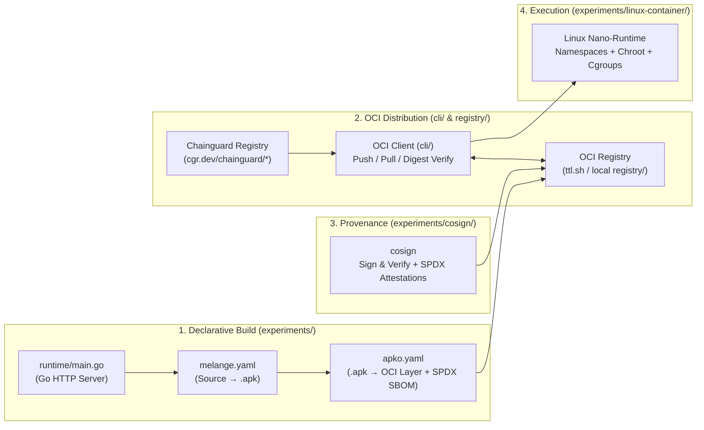

# Frankenstein-CI

> **A from-scratch exploration of the OCI ecosystem, Linux container internals, declarative Wolfi/`apko`/`melange` image builds, and cryptographic supply chain provenance in Go.**

`frankenstein-ci` is a miniature end-to-end container factory built without relying on the `docker` daemon or imperative `Dockerfile` builds. Every component is implemented or wired from first principles to dissect how hardened, distroless container images are built, distributed, verified, and executed.

---

## Architecture & End-to-End Flow



---

## Prerequisites

To run the experiments and build pipeline natively (Linux or WSL2 on Windows), install the following tools:

| Tool | Role in `frankenstein-ci` | Documentation / Releases |
| :--- | :--- | :--- |
| **Go (1.22+)** | Compiles the OCI CLI (`cli/`), OCI Registry (`registry/`), and Linux container runtime (`experiments/`). | [go.dev/dl](https://go.dev/dl/) |
| **`bubblewrap` (`bwrap`)** | Unprivileged Linux namespace sandbox used by `melange` as its default daemonless build runner. | [containers/bubblewrap](https://github.com/containers/bubblewrap) |
| **`melange`** | Chainguard's declarative APK compiler—compiles source code into signed Wolfi `.apk` packages. | [chainguard-dev/melange](https://github.com/chainguard-dev/melange) |
| **`apko`** | Chainguard's declarative OCI image assembler—builds distroless OCI images and SPDX SBOMs directly from `.apk` packages without Docker. | [chainguard-dev/apko](https://github.com/chainguard-dev/apko) |
| **`cosign`** | Sigstore tool for cryptographic container signing, verification, and in-toto SBOM attestations. | [sigstore/cosign](https://docs.sigstore.dev/cosign/system_config/installation/) |
| **Docker** *(Optional)* | Only used if you want to test loading the `apko` tarball via `docker load` (`make run-image`). Not required for building or publishing images. | [docs.docker.com](https://docs.docker.com/engine/install/) |

### Installing on Ubuntu / Debian / WSL2

1. **Install system packages (`bubblewrap` & `make`):**
   ```bash
   sudo apt-get update && sudo apt-get install -y bubblewrap make
   ```
2. **Install `melange`, `apko`, and `cosign` natively:**
   * **Option A — Via Go (`go install`):**
     ```bash
     go install chainguard.dev/melange@latest
     go install chainguard.dev/apko@latest
     go install github.com/sigstore/cosign/v2/cmd/cosign@latest
     # Ensure $(go env GOPATH)/bin is in your PATH
     ```
   * **Option B — Extract static binaries directly from Chainguard's distroless images (or GitHub Releases):**
     ```bash
     for tool in melange apko cosign; do
       docker pull cgr.dev/chainguard/$tool:latest
       cid=$(docker create cgr.dev/chainguard/$tool:latest)
       sudo docker cp $cid:/usr/bin/$tool /usr/local/bin/$tool
       docker rm $cid
       sudo chmod +x /usr/local/bin/$tool
     done
     ```
3. **Verify your local setup and generate signing keys:**
   ```bash
   make setup
   ```

---

## Repository Map

```text
frankenstein-ci/
├── go.mod
├── Makefile                 # End-to-end automation (setup, keys, melange, apko, cosign)
├── README.md
│
├── cli/                     # Milestone 1: Pure-Go OCI Registry Client (Pull & Push)
│   └── pull.go              # Token handshake, multi-arch OCI Index resolution, parallel layer downloads & whiteout extraction
│
├── registry/                # Milestone 4 (Stretch): OCI Distribution Spec / Mini-Chainguard Factory
│   ├── cmd/
│   │   └── main.go          # HTTP server entrypoint
│   └── internal/            # Content-addressable blob store (SHA-256), SBOM index & rebuild pipeline
│
├── experiments/             # Hands-on dissections of container internals & Chainguard tooling
│   ├── linux-container/     # Milestone 2: Linux Nano-Runtime (namespaces, chroot, /proc mount, cgroups)
│   │   └── main.go
│   ├── runtime/             # Milestone 3 Target App: Minimal Go HTTP server packaged via melange & apko
│   │   └── main.go
│   ├── apko/                # Milestone 3a: Declarative Wolfi image assembly & build-time SPDX SBOMs
│   │   ├── apko.yaml
│   │   └── sbom-*.spdx.json
│   ├── melange/             # Milestone 3b: Compiling Go source into a signed Wolfi .apk package
│   │   └── melange.yaml
│   ├── cosign/              # Milestone 5: Cryptographic image signing & attestation verification
│   │   └── cosign.pub
│   └── images/              # Extracted root filesystems (e.g., cgr.dev/chainguard/static) for inspection
│
├── pkg/                     # Shared Go libraries across CLI and Registry
│   ├── host/                # Host OS/architecture detection & OCI platform normalization
│   │   └── arch.go
│   └── rest/                # Generic typed HTTP/JSON client
│       └── client.go
│
└── bruno/                   # API request collection for inspecting OCI registry handshakes & manifests
```

---

## Milestones

### Milestone 1: The Raw OCI Puller (`cli/pull.go`) — ✅ Completed

> Forget the `docker` CLI exists. An OCI registry is an HTTP server serving content-addressable JSON descriptors and `.tar.gz` layer blobs.

* **What it does:** Talks directly to Chainguard's public registry (`cgr.dev/chainguard/*`), negotiates Bearer token authentication, resolves the multi-architecture **OCI Image Index** (`application/vnd.oci.image.index.v1+json`) for the host CPU architecture, downloads compressed layer blobs concurrently using `errgroup`, and extracts them sequentially into `experiments/images/<name>` while respecting OCI whiteout files (`.wh.*`).
* **Run it:**
  ```bash
  # Pull Chainguard's distroless static image from cgr.dev
  go run ./cli/pull.go static
  ```
* **Key Takeaways from Inspecting `cgr.dev/chainguard/static`:**
  * **Distroless by Default:** `/bin` and `/usr/bin` contain zero shells (`/bin/sh`) and zero package managers (`apk`), eliminating RCE shell-out vectors and unnecessary CVEs.
  * **Declarative Provenance (`/etc/apko.json`):** Contains the exact pinned Wolfi packages (`wolfi-baselayout`, `ca-certificates-bundle`, `tzdata`) and unprivileged user configuration (`nonroot`, UID `65532`).
  * **Scanner Transparency (`/usr/lib/apk/db/installed` & `/var/lib/db/sbom/*.spdx.json`):** Even without the `apk` binary present, `apko` writes the package database and per-package SPDX SBOMs so vulnerability scanners can audit the rootfs without executing code inside the container.

---

### Milestone 2: The Linux Nano-Runtime (`experiments/linux-container/main.go`) — ✅ Completed

> A "container" is not a hardware boundary—it is a standard Linux process isolated by kernel namespaces, a restricted root filesystem, and cgroup resource limits.

* **What it does:** Spawns a child process using `syscall.CLONE_NEWUTS | syscall.CLONE_NEWPID | syscall.CLONE_NEWNS`, isolates the root filesystem via `syscall.Chroot` into an extracted image directory, mounts `/proc` and a `tmpfs` mount inside the namespace, and configures cgroup process limits (`pids.max`).
* **Run it (Linux / WSL2 as root):**
  ```bash
  go run ./experiments/linux-container/main.go run /bin/sh
  ```

---

### Milestone 3: Declarative Image Building with Wolfi, `melange`, and `apko` (`experiments/runtime/`, `experiments/melange/`, `experiments/apko/`) — ✅ Completed

> Replace imperative, non-reproducible `Dockerfile` `RUN` layers with declarative package compilation (`melange`) and daemonless image assembly (`apko`).

* **How It Works End-to-End:**
  1. **`make build-apk` (`melange`):** Spins up an isolated `bubblewrap` build environment with the Wolfi Go toolchain, compiles [`experiments/runtime/main.go`](./experiments/runtime/main.go) into a static binary, packages **only** `/usr/bin/frankenstein-runtime` into a Wolfi `.apk` (`frankenstein-runtime-0.1.0-r0.apk`), and cryptographically signs the package with `melange.rsa`.
  2. **`make build-image` (`apko`):** Verifies the `.apk` signatures against `wolfi-signing.rsa.pub` and `melange.rsa.pub`, merges `wolfi-baselayout`, `ca-certificates-bundle`, `tzdata`, and `frankenstein-runtime` into a single flattened OCI layer (`3.39 MB` compressed / `13.6 MB` uncompressed), configures the unprivileged `nonroot` user (`UID 65532`), and emits build-time SPDX SBOMs (`sbom-x86_64.spdx.json`, `sbom-index.spdx.json`).
  3. **`make run-image`:** Loads `experiments/apko/image.tar` and runs the distroless container on `http://localhost:8080`:
     ```json
     {
       "message": "Hello from a distroless Wolfi container built with melange + apko!",
       "os": "linux",
       "arch": "amd64",
       "uid": 65532,
       "gid": 65532,
       "pid": 1
     }
     ```
  * **Security Verification:** Running `docker exec -it <container> /bin/sh` fails immediately (`stat /bin/sh: no such file or directory`), confirming the runtime container contains zero shells or package managers.

---

### Milestone 4: Cryptographic Supply Chain Provenance (`experiments/cosign/`) — ✅ Completed

> A container image is only trustworthy if its identity and build provenance are cryptographically verifiable.

* **How It Works End-to-End (`make all`):**
  1. **`make publish-image`:** Uses `apko publish` to push the image directly to an OCI registry (`ttl.sh/frankenstein-runtime:1h`) without a Docker daemon and records its immutable content-addressable digest (`@sha256:b6e99545...`).
  2. **`make sign` & `make verify`:** Signs the immutable image digest using Sigstore's `cosign` (`cosign.key`) and verifies the cryptographic signature against `experiments/cosign/cosign.pub`.
  3. **`make attest` & `make verify-attestation`:** Attaches the build-time SPDX SBOM (`experiments/apko/sbom-index.spdx.json`) as a signed in-toto attestation directly onto the OCI image in the registry, and verifies the attestation payload.

---

### Milestone 5 (Stretch): Mini Chainguard Container Factory & Registry (`registry/`) — 📋 Planned / Design Study

> Explore the system design of a continuous zero-CVE container factory: OCI distribution, SBOM indexing, CVE feed ingestion, and automated `apko` rebuilds.

* **Architecture Goals:**
  1. **OCI Distribution Registry:** Serve and accept OCI manifests, blobs (`sha256` CAS), and OCI 1.1 Referrers (signatures & SBOM attestations).
  2. **SBOM & Package Dependency Graph:** Index the SPDX SBOMs of published images (`image -> [package@version]`).
  3. **CVE Feed & Automated Rebuild Loop:** Ingest a vulnerability/advisory feed (or Wolfi package update event), query which images depend on the affected package, trigger an idempotent `apko` rebuild + `cosign` re-signing job, and emit a customer webhook/notification.
